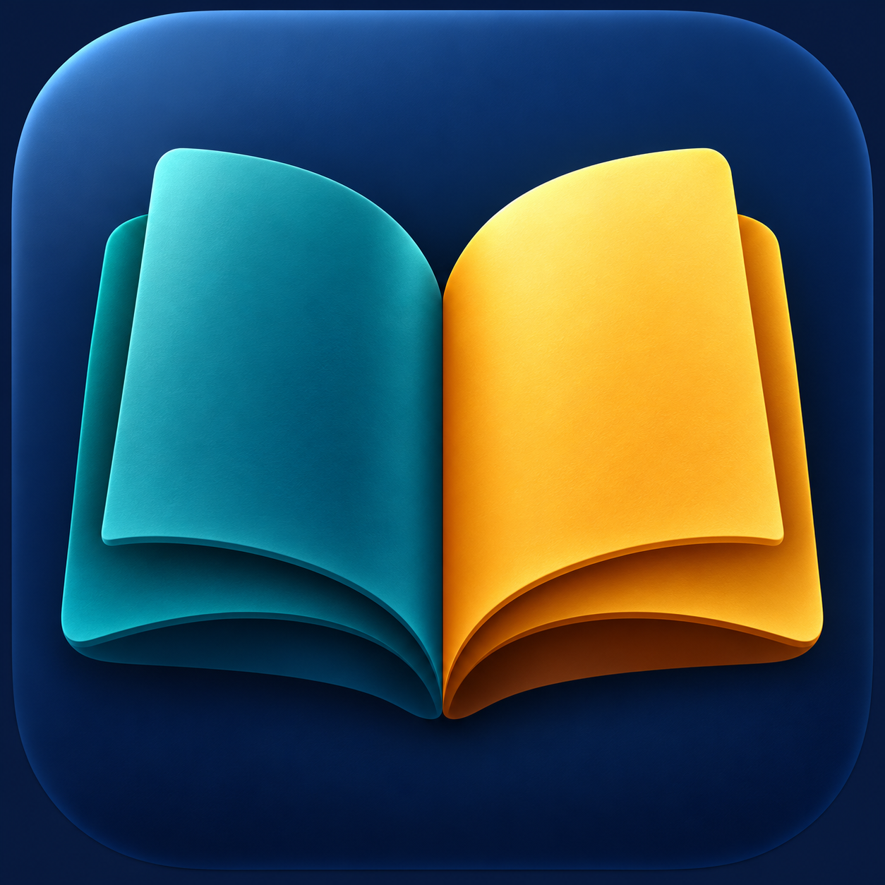

# Rava Dictionary



Rava is a native, offline dictionary for macOS 13 and later. It searches six
directions: English → Persian, Persian → English, German → English,
English → German, German → Persian, and Persian → German. It also has saved
words and system text to speech. Search runs locally with no account or API.

## Download

Download `Rava-1.0.0-macOS.zip` from the [Releases](../../releases) page,
unzip it, and move `Rava.app` to Applications. This build is not notarized or
signed with an Apple Developer ID; macOS may ask you to approve opening it in
System Settings → Privacy & Security. The app does not require network access.

## Build

Run `./build.sh` with the Swift command line tools installed. The ready-to-use
SQLite index is included in `Resources/dictionary.sqlite`.

To reproduce the index from source data, first run
`Scripts/build_dictionary.py` with the Openjam `data/json` directory, then
download the WikDict `wikdict-de-en.zip` and `wikdict-en-de.zip` StarDict
archives and run `Scripts/add_wikdict.py`:

```sh
python3 Scripts/build_dictionary.py /path/to/openjam/data/json Resources/dictionary.sqlite
python3 Scripts/add_wikdict.py Resources/dictionary.sqlite /path/to/wikdict-de-en.zip /path/to/wikdict-en-de.zip
./build.sh
```

## Data and accuracy

The English–Persian data comes from [Openjam](https://github.com/amirj4m/openjam)
at commit `e05622665494f18d414190b5f738dc1eb4b414fa` under MIT terms.
The German–English data comes from [WikDict](https://www.wikdict.com/page/download)
under [CC BY-SA 4.0](https://creativecommons.org/licenses/by-sa/4.0/).
The packaged index combines these sources; the transformed WikDict data and
German–Persian derived entries are CC BY-SA 4.0. See
[WIKDICT_ATTRIBUTION.md](WIKDICT_ATTRIBUTION.md) and
[ATTRIBUTION.md](ATTRIBUTION.md).

German–Persian results are inferred through exact English equivalents.
Polysemous words can produce incorrect meanings, so the app labels these
results and shows the English bridge word. They should be checked before use
in important contexts. Direct English–Persian meanings are also sourced from
community reviewed AI translations and may contain errors.

Rava is independent of Dict Box. It does not contain its binary, proprietary
dictionary, account features, or paid content.
